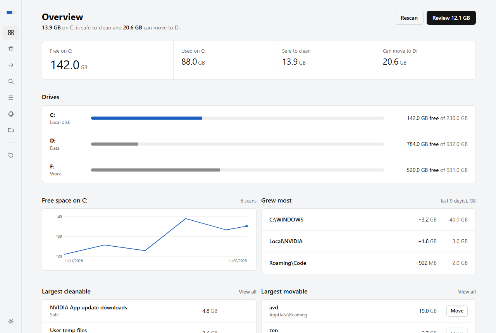
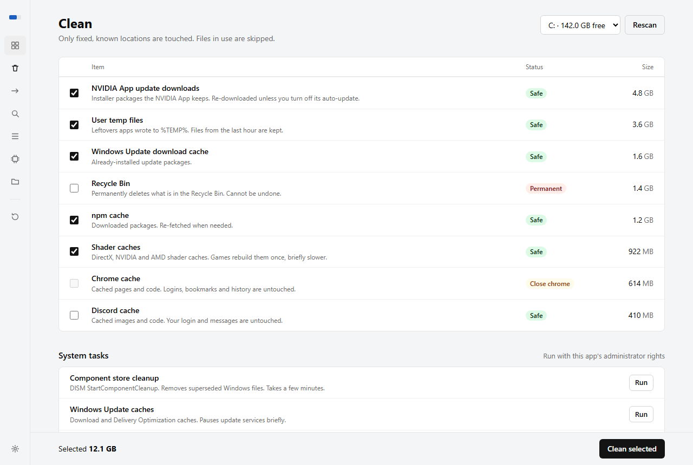
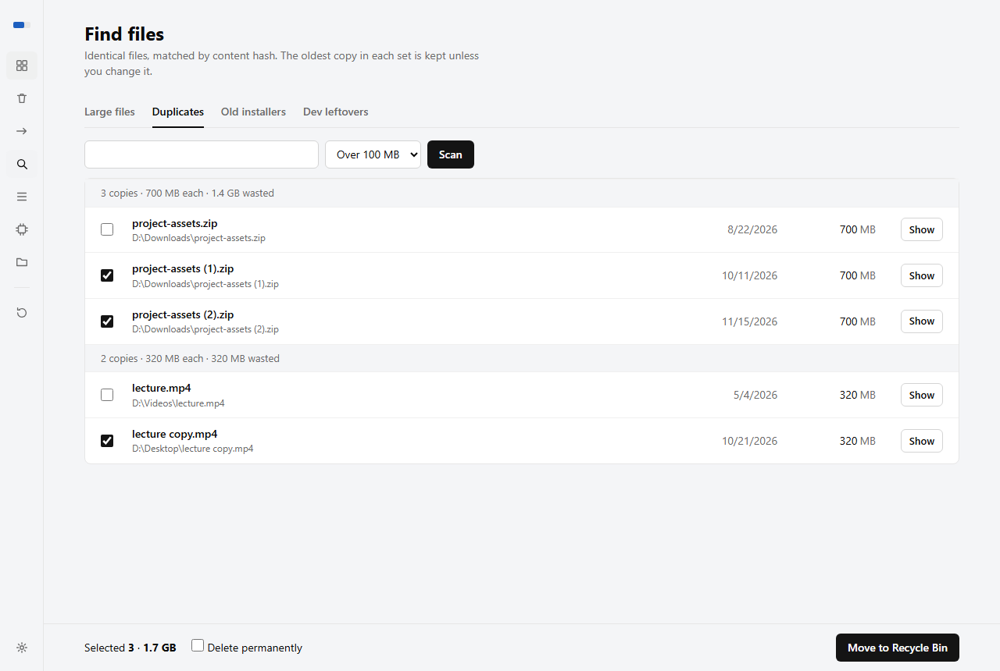
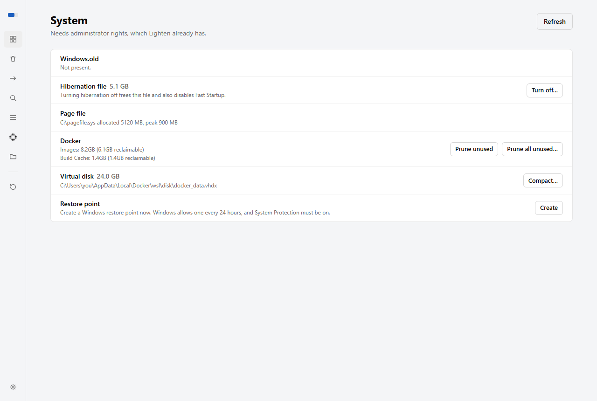
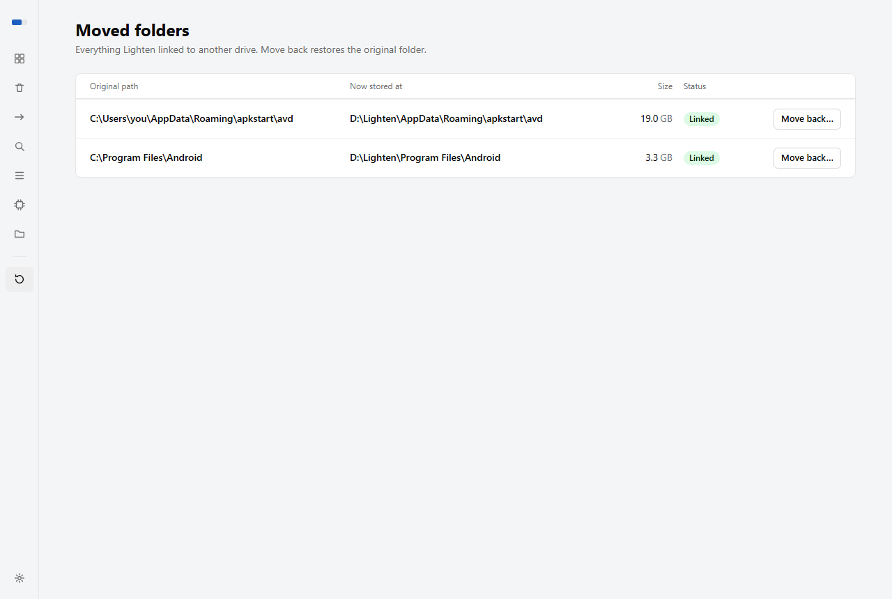

<div align="center">

# Lighten

**Get your C: drive back. Safely.**

A fast, no-nonsense Windows disk cleaner. Finds junk, big files, duplicates and forgotten apps, then frees space by cleaning or by moving folders to another drive with a junction, so nothing breaks.

[**Download Lighten.exe**](https://github.com/RDK456/leaveCalone/releases/latest) · Windows 10/11 · ~9 MB · no installer needed



</div>

> Screenshots use sample data.

## Why Lighten

- **Nothing breaks.** Every delete is limited to known-safe locations. Every move is verified and rolls back on any failure.
- **See before you clean.** Each item shows its size and what it does. Dry-run report deletes nothing.
- **Pick your drive.** Clean any drive. Move folders to any other drive.
- **Tiny and native.** Tauri + Rust. No telemetry. No account. No ads.

## Features

### Clean
17 categories: temp files, shader caches, npm/pip/NuGet/Cargo caches, Chrome/Edge/Brave/Discord caches, Windows Update cache, Delivery Optimization, crash dumps, NVIDIA installers, logs and the Recycle Bin. Running apps are detected and skipped.



### Move to another drive
Move AppData folders, profile folders and Program Files apps to D: (or any drive) and keep them working through an NTFS junction.

1. Copy with robocopy, keeping timestamps
2. Verify file count and bytes
3. Rename original, create junction, verify
4. Delete the old copy. Any failed step rolls back.

**Move back** undoes it with one click. Existing junctions are detected and adopted.


### Find big, duplicate and old files
- **Large files** across any drive
- **Duplicates** matched by size, partial hash, then full SHA-256
- **Old installers** (`.exe`, `.msi`, `.iso`) in Downloads
- **Dev leftovers** like idle `node_modules` and Rust `target` folders

Deletes go to the **Recycle Bin first**. Permanent delete is opt-in.



### Apps
Installed apps with size and last-used date. Uninstall, or move a large app to another drive.


### System
Windows.old, hibernation file, pagefile info, Docker prune, WSL/Docker disk compaction, and a restore point before big cleans.



### Moved folders and growth
See everything you moved, its status, and restore it. Track free space over time and see which folders grow fastest.



### Automation
- Scheduled background scan via Task Scheduler, with a toast notification
- Optional auto-clean of the safe set only
- Tray icon, close-to-tray
- Signed delta updater (ed25519 + SHA-256, small binary patches)


## Safety model

- Clean targets come from a fixed allowlist. No wildcard roots.
- Delete actions only act on paths a finder just returned to you.
- System, Microsoft and other protected folders are on a deny list and can't be moved.
- Reparse points are never followed during scans or deletes.
- Running processes and services that use a folder block its move.
- Moves are journaled in `%LOCALAPPDATA%\Lighten\moves.json`.

## Install

1. Download `Lighten.exe` from [Releases](https://github.com/RDK456/leaveCalone/releases/latest).
2. Run it. Windows asks for admin rights; Lighten needs them to clean system caches and create junctions.
3. Optional: Settings → install to Program Files for a Start Menu shortcut and uninstaller.

**SmartScreen warning?** The exe is not code-signed yet, so Windows may say "unknown publisher". Choose *More info → Run anyway*. Source is in this repo; build it yourself if you prefer.

## Build

Needs Rust (stable) and the WebView2 runtime.

```powershell
cargo build --release
# output: target\release\lighten.exe
```

The UI is plain HTML/CSS/JS in `dist/`. No bundler.

### Updater and signing

Updates are verified with an ed25519 signature over `"<version>\n<sha256>"`. The public key is `update.pub`. The private key is never stored in this repo.

```powershell
lighten.exe --gen-key key.txt
lighten.exe --make-patch old.exe new.exe out.patch
lighten.exe --sign key.txt 0.0.2 <sha256> sig.txt
```

## Status

v0.0.1, early. Tested: scanning, delta patching, signing, and the UI. Real deletes, restore points, install and updater restart need more testing on varied machines. Back up what matters and use the dry-run report first.
