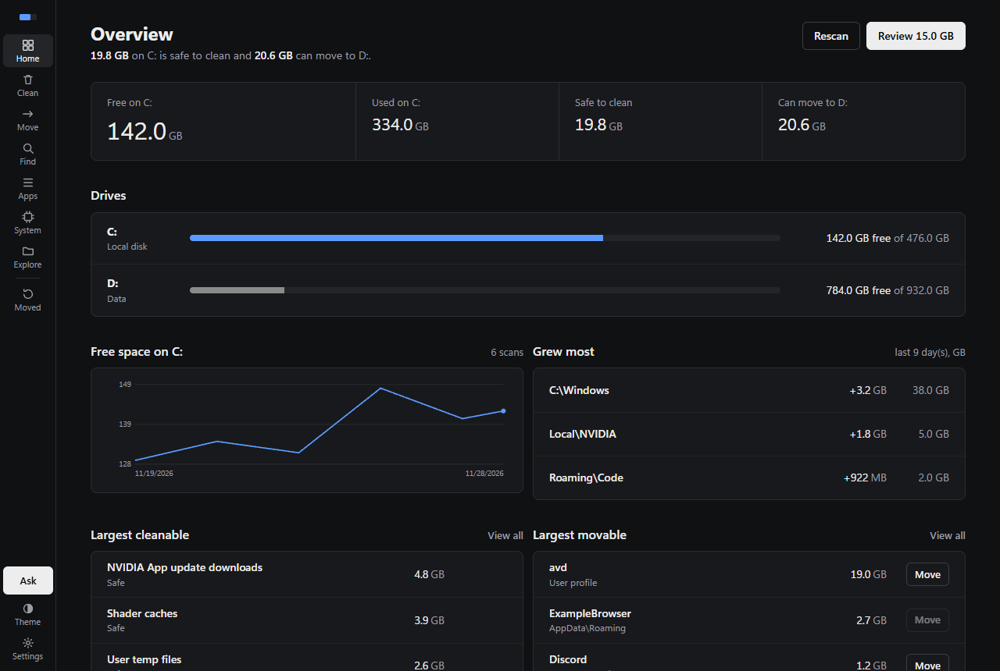
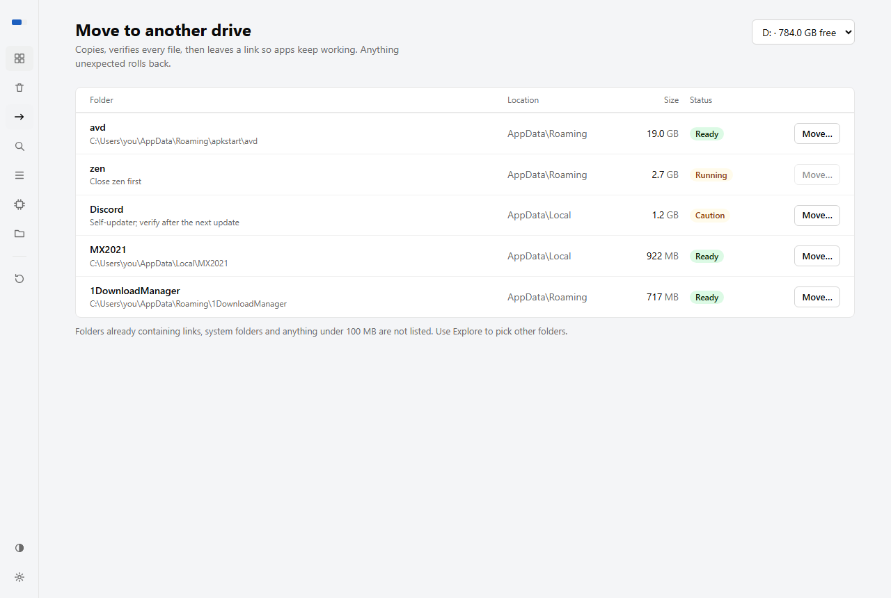
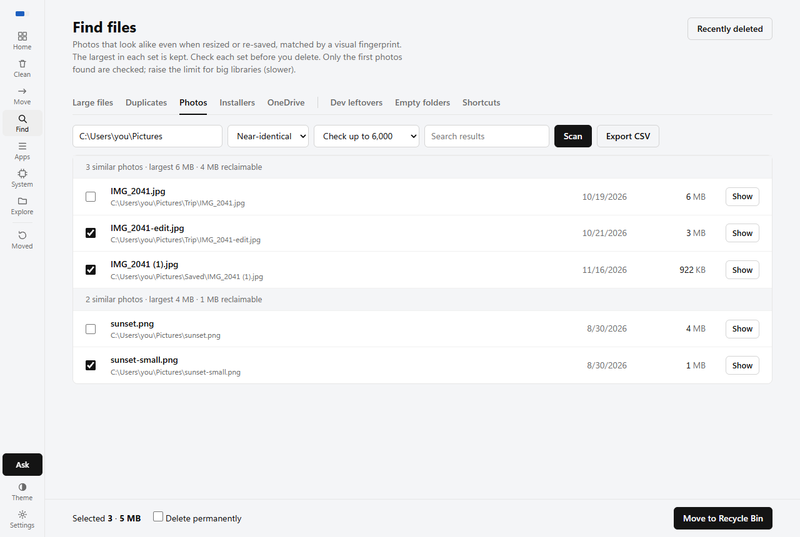
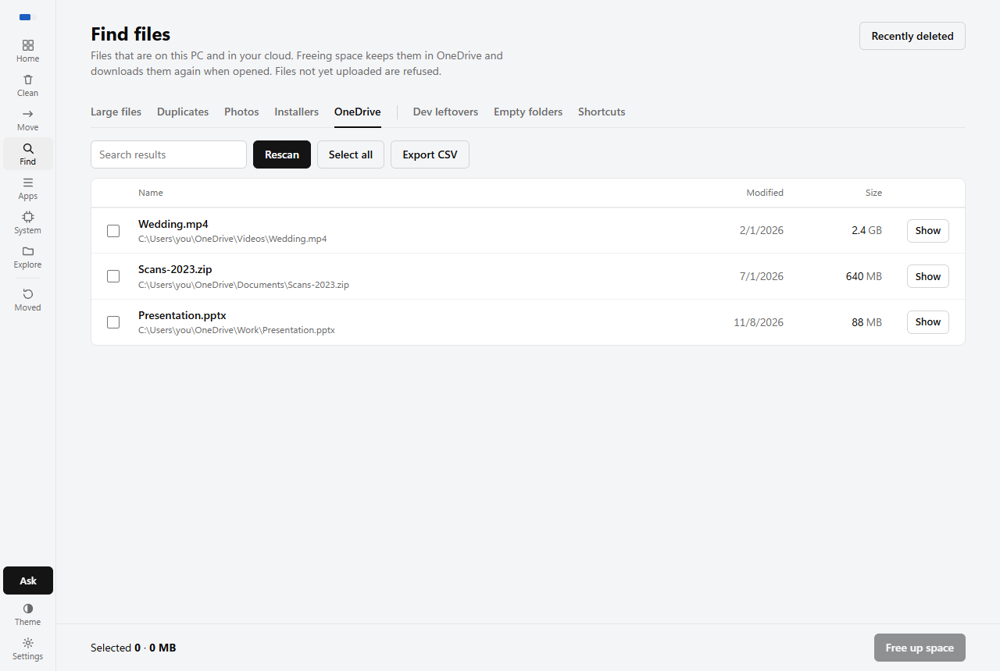
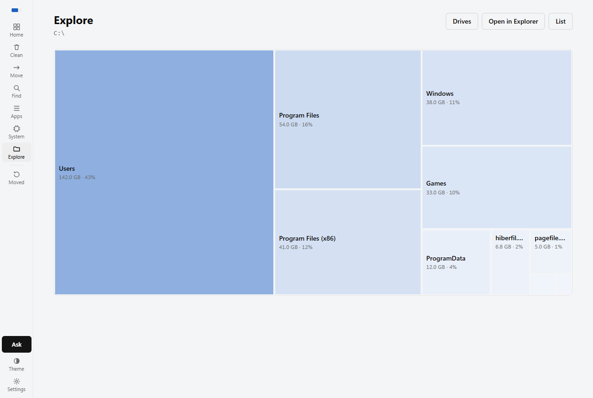
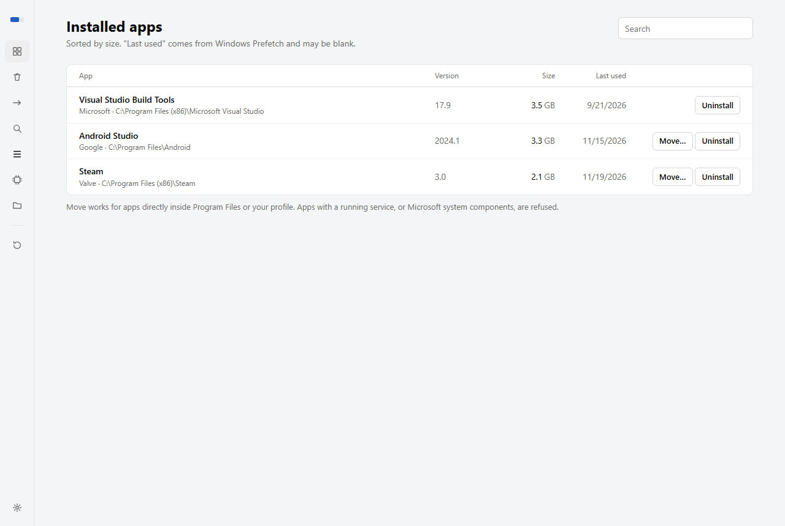
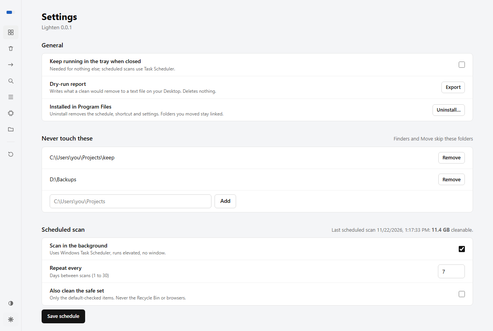

<div align="center">

# Lighten

**Get your C: drive back. Safely.**

A fast, no-nonsense Windows disk cleaner. Finds junk, big files, duplicates and forgotten apps, then frees space by cleaning or by moving folders to another drive with a junction, so nothing breaks.

[**Download Lighten.exe**](https://github.com/RDK456/leaveCalone/releases/latest) · Windows 10/11 · ~9 MB · no installer needed




</div>

> Screenshots use sample data.

## Why Lighten

- **Nothing breaks.** Every delete is limited to known-safe locations. Every move is verified and rolls back on any failure.
- **See before you clean.** Each item shows its size and what it does. Dry-run report deletes nothing.
- **Pick your drive.** Clean any drive. Move folders to any other drive.
- **Tiny and native.** Tauri + Rust. No telemetry. No account. No ads.

## Features

### Clean
32 categories in five groups, with select all and none: temp files, shader caches, npm/pnpm/pip/uv/NuGet/Cargo/Yarn/Gradle caches, Chrome/Edge/Brave/Firefox/Discord/Slack/Teams/Spotify/VS Code caches, Steam, Epic Games and Adobe media caches, thumbnail cache, Windows Update cache, Delivery Optimization, crash dumps, NVIDIA installers, logs and the Recycle Bin. Running apps are detected and skipped. Your ticks survive a rescan.


### Move to another drive
Move AppData folders, profile folders and Program Files apps to D: (or any drive) and keep them working through an NTFS junction.

1. Copy with robocopy, keeping timestamps
2. Verify file count and bytes
3. Rename original, create junction, verify
4. Delete the old copy. Any failed step rolls back.

**Move back** undoes it with one click. Existing junctions are detected and adopted.



### Find anything wasting space
Eight finders in one place:

- **Large files**: reads the NTFS file table directly, so a whole drive takes seconds
- **Duplicates**: matched by size, partial hash, then full SHA-256
- **Similar photos**: resized or re-saved copies, matched by a visual fingerprint
- **Installers**: old installers in Downloads, Desktop and Documents, wherever Windows keeps them (OneDrive too)
- **Dev leftovers**: idle `node_modules`, Rust `target` and Python venv folders
- **Empty folders**: only folders with nothing inside, nothing pre-selected
- **Broken shortcuts**: Desktop and Start menu links whose target is gone
- **OneDrive**: free up space on files that stay in the cloud

**Recently deleted** restores anything Lighten sent to the Recycle Bin.

Deletes go to the **Recycle Bin first**. Permanent delete is opt-in.

Search and sort the results, export them to CSV, and watch or cancel long scans.






### Explore with a treemap
Fast scan reads the NTFS file table, then every folder opens instantly. Switch between a list and a treemap where bigger tiles use more space.



### Apps
Installed apps with size and last-used date. Uninstall, or move a large app to another drive. The uninstall command is shown first; apps installed for your account only open Windows' Installed apps page, so their uninstaller never runs as administrator.



### System
Windows.old, hibernation file, pagefile info, Docker prune, WSL/Docker disk compaction, a restore point before big cleans, a real-size report of the WinSxS component store, and your startup apps with one-click on/off. Shows how much space Ollama, Hugging Face and LM Studio models use (never deleted).


### Moved folders and growth
See everything you moved, its status, and restore it. Track free space over time and see which folders grow fastest.


### Automation
- Scheduled background scan via Task Scheduler, with a toast notification (installed copy only)
- Optional auto-clean of the safe set only
- Tray icon, close-to-tray
- Light and dark theme
- An exclusion list: folders that finders and Move never touch
- Free-space drop alert: a banner and notification when C: loses 10 GB or more, with what grew
- Hidden-space check: Fast scan flags large files the disk lists but Windows cannot find, with a one-click disk check (`chkdsk /f`) scheduled for the next restart
- Every setting has a plain-language explanation
- Recent cleanups: what was cleaned, deleted or moved, and when
- Explorer right-click: "Analyze with Lighten" on any folder or drive
- Ask box: type a problem ("C: is full", "protect a folder") and it opens the page or setting that fixes it; works offline, keyword-based
- Command line: `Lighten.exe --scan`, `--clean`, `--version`, `--help` `--analyze <folder>` (output shows when launched from an elevated terminal)
- Signed delta updater (ed25519 + SHA-256, small binary patches)



## Safety model

- Clean targets come from a fixed allowlist. No wildcard roots.
- Delete actions only act on paths a finder just returned to you.
- System, Microsoft and other protected folders are on a deny list and can't be moved.
- Reparse points are never followed during scans or deletes.
- Running processes and services that use a folder block its move.
- Excluded folders are skipped by every finder, by Clean and by Move. (Windows system tasks and emptying the Recycle Bin do not read the list.)
- Recycle Bin deletes are logged, so Undo can put them back.
- OneDrive "free up space" only touches synced placeholders; files not yet uploaded are refused.
- Empty folders are only removed if they are still empty at that moment.
- Windows tools are started by full path, so a look-alike program beside Lighten is never run.
- Admin scripts and file lists are passed in memory, never through files another program could swap.
- The scheduled task only runs the copy in Program Files. A task made by an older version that runs another copy is removed.
- A content security policy blocks outside and injected scripts.
- Moves are journaled in `%LOCALAPPDATA%\Lighten\moves.json`.

## Install

1. Download `Lighten.exe` from [Releases](https://github.com/RDK456/leaveCalone/releases/latest).
2. Run it. Windows asks for admin rights; Lighten needs them to clean system caches and create junctions.
3. Optional: Settings → install to Program Files for a Start Menu shortcut and uninstaller.

**SmartScreen warning?** The exe is not code-signed yet, so Windows may say "unknown publisher". Choose *More info → Run anyway*. Source is in this repo; build it yourself if you prefer.

## Build

Needs Rust (stable) and the WebView2 runtime.

```powershell
cargo build --release
# output: target\release\lighten.exe
```

The UI is plain HTML/CSS/JS in `dist/`. No bundler.

Tests: `cargo test` (set `__COMPAT_LAYER=RunAsInvoker` to run the test binary without an elevation prompt). The live NTFS check needs an elevated terminal: `cargo test mft_live -- --ignored`.

Code signing and a winget package are documented in [docs/SIGNING.md](docs/SIGNING.md) and [winget/make-manifest.ps1](winget/make-manifest.ps1).

### Releasing

Push a tag that matches the version in `Cargo.toml`. GitHub Actions tests, builds and creates a **draft** release for you to publish. Add the optional secrets named at the top of the workflow file to include the signed update manifest and a code signature. To build the manifest by hand:

```powershell
.\scripts\make-latest.ps1 -Exe .\Lighten.exe -Version 0.1.3 -KeyFile .\keys\update.key
```

Add `-PreviousExe` and `-PreviousVersion` to also write a small patch from the last release; upload it too.

The app looks for `latest.json` on the newest release unless you set another address, so upload it with every release.

### Updater and signing

Updates are verified with an ed25519 signature over `"<version>\n<sha256>"`. The public key is `update.pub`. The private key is never stored in this repo.

```powershell
lighten.exe --gen-key key.txt
lighten.exe --make-patch old.exe new.exe out.patch
lighten.exe --sign key.txt 0.0.2 <sha256> sig.txt
```

## Status

v0.1.3, early. Tested: scanning, cleaning (on test files), delta patching, signing, the NTFS table parser, the empty-folder, exclusion and photo-matching logic, the right-click entry and the UI. Fast scan, restore points, install and administrator-only cleaning need more testing on varied machines.

**Known issue:** in v0.1.3 and earlier, **Update** in the app closes Lighten without finishing. Download the new `Lighten.exe` from [Releases](https://github.com/RDK456/leaveCalone/releases/latest) instead. Back up what matters and use the dry-run report first.

## License

[MIT](LICENSE)
